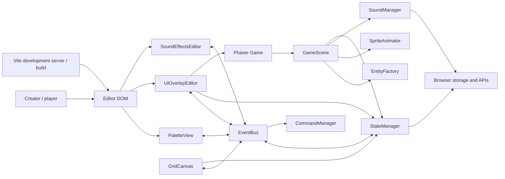
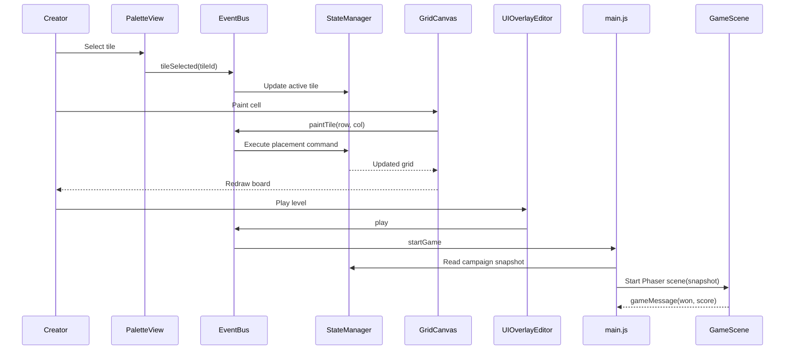

# Little Level Lab Architecture

## 1. Purpose and scope

Little Level Lab is a browser-based, child-friendly 2D platformer editor and
playable game runtime. The editor is built with native DOM and Canvas APIs;
Phaser 3 Arcade Physics powers the play mode. Vite serves the development app
and creates the production bundle.

The application currently runs entirely in the browser. Level files,
campaigns, user-uploaded sprites, animation sheets, and uploaded sounds are
handled client-side. There is no game server, account system, cloud save, or
multiplayer service.

## 2. System context



The diagram shows logical relationships rather than direct ownership. The
`EventBus` is a small wrapper around Phaser's event emitter and coordinates
loosely coupled editor components. `GameScene` receives a snapshot of a level
when play starts; it does not edit the live editor grid.

## 3. Source layout and responsibilities

| Area | Module | Responsibility |
|---|---|---|
| Application | `src/main.js` | Creates the shared editor services, wires events, prepares the two demo campaign levels, and opens/restarts Phaser play sessions. |
| Core | `src/core/StateManager.js` | Owns the editable grid, dimensions, tile catalog, demo data, sprite/audio metadata, level snapshot serialization, and validation. |
| Core | `src/core/CommandManager.js` | Implements tile placement, erasing, resizing, clearing, and bounded undo/redo history. |
| Core | `src/core/EventBus.js` | Provides `on`, `once`, `off`, `emit`, and listener cleanup around Phaser's `Events.EventEmitter`. |
| Editor | `src/editor/PaletteView.js` | Renders/selects tools, configures mystery-box rewards, and handles sprite/animation upload interactions. |
| Editor | `src/editor/GridCanvas.js` | Renders the non-gridded board, draws tile previews, and translates pointer painting into editor events. |
| Editor | `src/editor/UIOverlayEditor.js` | Handles level/campaign management, world resizing, file import/export, toolbar actions, and status messages. |
| Editor | `src/editor/SoundEffectsEditor.js` | Uploads, validates, previews, enables, removes, and adjusts per-event audio. |
| Runtime | `src/engine/GameScene.js` | Creates play-mode entities and colliders; processes movement, combat, collectibles, puzzles, checkpoints, scoring, particles, and level completion. |
| Runtime | `src/engine/EntityFactory.js` | Maps tile IDs to Phaser entities and creates fallback textures for built-in objects. |
| Runtime | `src/engine/SpriteAnimator.js` | Creates Phaser animations and chooses uploaded animation/fallback frames for entities. |
| Runtime | `src/engine/SoundManager.js` | Plays uploaded audio overrides or synthesizes built-in retro tones with Web Audio. |
| Assets | `src/assets/demo/` | Original bundled SVG sprites and per-action character sprite sheets. |
| Presentation | `src/styles/main.css`, `index.html` | Editor, palette, toolbar, canvas, dialogs, game modal, and touch-control layout. |

## 4. Runtime startup and data flow

### Editor startup

1. `src/main.js` creates a `StateManager`, snapshots the first demo, creates a
   second demo snapshot, and restores the first demo as the initial workspace.
2. The module creates one `EventBus`, `CommandManager`, `PaletteView`,
   `GridCanvas`, `UIOverlayEditor`, `SoundEffectsEditor`, `EntityFactory`, and
   `SpriteAnimator`.
3. DOM input emits events such as `tileSelected`, `paintTile`, `undo`, `redo`,
   `spriteUploaded`, `openSoundSettings`, and `play`.
4. `StateManager` updates the editable world; the canvas redraws it. Commands
   retain prior values to support undo and redo.

### Play-mode startup

1. `UIOverlayEditor` saves the current level snapshot into its in-memory
   campaign list and requests play.
2. `main.js` creates a game modal and Phaser `Game`, passing the selected
   snapshot, shared factories, touch-control state, event bus, and a
   level-specific record ID to `GameScene`.
3. `GameScene` creates textures, world/camera bounds, entity groups, physics
   colliders and overlaps, keyboard input, HUD, animations, and sound handling.
4. Gameplay events update the scene and emit `gameMessage` when a run ends.
   `main.js` presents replay, next-level, or replay-campaign actions.
5. Closing the modal destroys the Phaser instance and stops its active sounds.



## 5. World model and content

### Grid and tile catalog

The editor uses a 32-pixel tile size. The initial demo has 96 columns by 18
rows; the other built-in level has 72 columns by 18 rows. Users can resize
levels from 8–256 columns and 8–40 rows. Coordinates are stored as
`tiles[row][column]`; empty cells are `null`.

The supported tile IDs are:

- Start and terrain: `Player`, `Ground`, `Brick`, `MysteryBox`, `Pipe`.
- Movement surfaces and obstacles: `Spring`, `MovingPlatform`,
  `OneWayPlatform`, `Door`.
- Puzzle and respawn objects: `Switch`, `Checkpoint`.
- Enemies: `Goomba`, `Koopa`, `Bat`.
- Collectibles and rewards: `Coin`, `Mushroom`, `Star`, `ExtraLife`,
  `FireFlower`.
- Goal: `Flag`.

The eraser is an editor tool, not a stored tile type. The current editor palette
selects one mystery-box reward for all boxes in a level.

### Game rules in play mode

| Mechanic | Current behavior |
|---|---|
| Player movement | Keyboard arrows/A-D move; W, Up, or Space jumps; Shift runs; X or J shoots while Fire-powered. Touch controls provide left, right, and jump. |
| Jump feel | 120 ms jump buffering and coyote time; holding jump changes jump height; wall slide caps fall speed at 120 px/s; wall jump launches away from the contacted wall and briefly prioritizes that direction. |
| Movement speed | Normal horizontal movement is 180 px/s; run is 290 px/s; the big-player speed is 220 px/s unless running. |
| Spring | Landing launches the player upward at 640 px/s. |
| Moving platform | Travels horizontally between 64 px either side of its placement at 56 px/s and carries a player standing on it. |
| One-way platform | Collides only from above, allowing the player to jump up through it. |
| Switch and door | Touching one switch disables/removes all closed doors in that level. |
| Checkpoint | The latest touched checkpoint becomes the respawn position. Falling costs a life; if lives remain, the player respawns there after a short animation, in normal form and without Fire/Star powers. |
| Enemies | Goomba and Koopa patrol horizontally; Bat flies. Stomps, Star power, and fireballs defeat enemies. |
| Fire Flower | Grants a Fire ability. X/J emits a directional fireball with a cooldown; it disappears on a solid obstacle, enemy, or timeout. |
| Other power-ups | Mushroom grows the player; Star grants eight seconds of invincibility; Extra Life adds one life. |
| Completion | Touching `Flag` wins. Falling without an activated checkpoint or losing all lives ends the run. |

The Phaser Arcade Physics world uses vertical gravity of 800 px/s². Camera
tracking follows the player; the rendered game view is 960×540 and scales to
fit its container.

## 6. Asset and feedback pipeline

- Built-in character actions are stored independently (for example
  `Player-idle.svg`, `Player-walk.svg`, `Player-run.svg`, and `Player-jump.svg`).
  Sprite metadata contains the image data, frame width/height/count, and frame
  rate. The editor can replace these with uploaded images/sprite sheets.
- The supported character animation sets are Player (`idle`, `walk`, `run`,
  `jump`) and Goomba/Koopa/Bat (`idle`, `walk`).
- Tile images and audio are loaded as data URLs into the level snapshot.
- `SpriteAnimator` creates Phaser animation keys per entity and action; missing
  actions fall back to another available action or the entity's base texture.
- `SoundManager` synthesizes a built-in tone for known events. When a sound
  entry exists in the level, it overrides the built-in tone; disabled or muted
  uploaded entries intentionally remain silent.
- The sound editor supports uploaded audio, preview, enable/disable, volume,
  and removal. Uploads are limited to 10 MB.
- `GameScene.emitBurst` creates short-lived tweened particles for key gameplay
  feedback. Camera shake is used for selected major events.

## 7. Persistence and validation

### Level files

`StateManager.getWorldSnapshot()` returns a JSON-compatible object containing:

```json
{
  "cols": 72,
  "rows": 18,
  "tiles": [["..."]],
  "activeTileType": "Ground",
  "spriteMetadata": {},
  "soundEffects": {},
  "mysteryBoxReward": "Mushroom"
}
```

The abbreviated `tiles` value above is illustrative; a real file contains one
array per row and one nullable tile ID per cell. Uploaded sprite/audio data URLs
are stored inline. `validateWorld()` checks dimensions, matrix shape, supported
tile IDs, mystery-box reward, and audio metadata. Older files may omit
`soundEffects` or `mysteryBoxReward`; defaults are applied when restoring.

### Campaigns

Campaign JSON uses format `little-level-lab-campaign`, version `1`, and a
`levels` array of `{ "name", "snapshot" }` objects. Campaigns contain 1–50
levels; names must be non-empty and are limited to 60 characters on import.
Level and campaign saves download JSON files. Users must explicitly save;
campaign edits are held in memory during the session.

### Best-score records

The runtime stores the best score by campaign position and level name in
browser `localStorage`, using keys under
`little-level-lab:best:<encoded-level-id>`. Records are local to the browser and
are not embedded in exported level/campaign files.

## 8. Extension guidelines

When adding a tile or mechanic:

1. Add its ID to `StateManager`'s allowed tile list and ensure old snapshot
   defaults/validation remain compatible.
2. Add a toolbox entry and a canvas preview.
3. Register its Phaser entity/texture in `EntityFactory`.
4. Add its scene group, collider/overlap, and behavior in `GameScene`.
5. Update demo content and the user-facing specification/README when relevant.
6. Exercise it in play mode and run `npm run build`.

When adding a configurable sound event, update the accepted event IDs in
`StateManager`, the sound settings UI, a built-in sound preset if desired, and
the gameplay trigger. Prefer `EventBus` for communication between the DOM
editor and game runtime.

## 9. Development and verification

Run `npm install`, `npm run dev`, and open the URL reported by Vite. Validate
production output with `npm run build`; use `npm run preview` to serve that
build. The package currently defines no dedicated unit, lint, or automated
browser-test script, so gameplay behavior must also be manually exercised in
the browser.

The project is client-side only. Uploaded assets/audio are embedded in JSON,
campaigns are not automatically persisted, and best scores are browser-local.
These are current product boundaries rather than server-backed guarantees.
