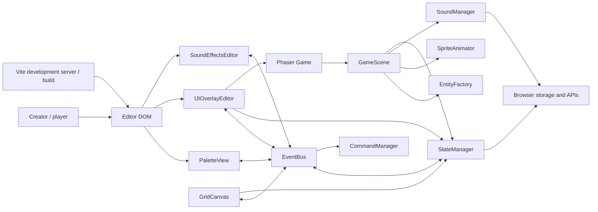
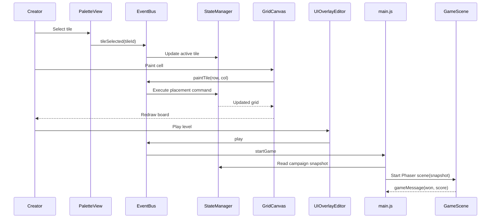

# Little Level Lab Architecture

## 1. Purpose and scope

Little Level Lab is a browser-based, child-friendly 2D platformer editor and
playable game runtime. The editor is built with native DOM and Canvas APIs;
Phaser 3 Arcade Physics powers the play mode. Vite serves the development app
and creates the production bundle.

The application currently runs entirely in the browser. Level files,
campaigns, user-uploaded sprites, animation sheets, and uploaded sounds are
handled client-side. There is no game server, account system, cloud save, or
multiplayer service.

GitHub Pages deployment is handled by `.github/workflows/deploy.yml`, which
builds the Vite app on pushes to `main` and deploys the `dist` artifact. The
Vite base path is `/KidCodeArcade/` for GitHub Actions builds and `/` for local
development/preview.

## 2. System context



The diagram shows logical relationships rather than direct ownership. The
`EventBus` is a small wrapper around Phaser's event emitter and coordinates
loosely coupled editor components. `GameScene` receives a snapshot of a level
when play starts; it does not edit the live editor grid.

## 3. Source layout and responsibilities

| Area | Module | Responsibility |
|---|---|---|
| Application | `src/main.js` | Creates the shared editor services, wires events, prepares the demo campaign levels, and opens/restarts Phaser play sessions. |
| Core | `src/core/StateManager.js` | Owns the editable grid, dimensions, tile catalog, per-cell visual variants, demo data, sprite/audio metadata, level snapshot serialization, and validation. |
| Core | `src/core/CommandManager.js` | Implements tile placement, erasing, bulk visual changes, resizing, clearing, and bounded undo/redo history. |
| Core | `src/core/EventBus.js` | Provides `on`, `once`, `off`, `emit`, and listener cleanup around Phaser's `Events.EventEmitter`. |
| Editor | `src/editor/PaletteView.js` | Renders/selects tools, configures mystery-box rewards, boss and Creepy behavior, static-tile appearances, and image/animation uploads. |
| Editor | `src/editor/GridCanvas.js` | Renders the non-gridded board and selected per-cell appearances, and translates pointer painting into editor events. |
| Editor | `src/editor/UIOverlayEditor.js` | Handles level/campaign management, world resizing, file import/export, toolbar actions, and status messages. |
| Editor | `src/editor/SoundEffectsEditor.js` | Uploads, validates, previews, enables, removes, and adjusts per-event audio. |
| Runtime | `src/engine/GameScene.js` | Creates play-mode entities and colliders; processes movement, combat, collectibles, puzzles, checkpoints, scoring, particles, and level completion. |
| Runtime | `src/engine/EntityFactory.js` | Maps tile IDs to Phaser entities and creates fallback textures for built-in objects. |
| Runtime | `src/engine/SpriteAnimator.js` | Creates Phaser animations and chooses uploaded animation/fallback frames for entities. |
| Runtime | `src/engine/SoundManager.js` | Plays uploaded audio overrides or synthesizes built-in retro tones with Web Audio. |
| Assets | `src/assets/demo/` | Original crisp-edge SVG pixel art, the Sunny Hero and Bumble Bug animation sheets, and per-object appearance variants. |
| Presentation | `src/styles/main.css`, `index.html` | Editor, palette, toolbar, canvas, dialogs, game modal, and touch-control layout. |

## 4. Runtime startup and data flow

### Editor startup

1. `src/main.js` creates a `StateManager`, snapshots the three built-in demo
   levels, and restores Sunny Hills as the initial workspace.
2. The module creates one `EventBus`, `CommandManager`, `PaletteView`,
   `GridCanvas`, `UIOverlayEditor`, `SoundEffectsEditor`, `EntityFactory`, and
   `SpriteAnimator`.
3. DOM input emits events such as `tileSelected`, `tileVariantSelected`,
   `applyTileVariantToAll`, `paintTile`, `undo`, `redo`, `spriteUploaded`,
   `boardPanModeChanged`, `openSoundSettings`, and `play`.
4. `StateManager` updates the editable world; the canvas redraws it. Commands
   retain prior values to support undo and redo.

The campaign toolbar's **＋ Level** dialog collects a level name and insertion
position. `UIOverlayEditor` inserts a snapshot with an all-empty tile grid,
selects the Player tool, and makes the new level active. On touch devices,
**Move board** toggles `GridCanvas` between painting and drag-to-pan input so
navigation does not place tiles accidentally.

### Play-mode startup

1. `UIOverlayEditor` saves the current level snapshot into its in-memory
   campaign list and requests play.
2. `main.js` creates a game modal and Phaser `Game`, passing the selected
   snapshot, shared factories, touch-control state, event bus, and a
   level-specific record ID to `GameScene`.
3. `GameScene` creates textures, world/camera bounds, entity groups, physics
   colliders and overlaps, keyboard input, HUD, animations, and sound handling.
   Play mode uses a 1.35× follow-camera zoom and Phaser's pixel-art rendering.
   Player and Creepy sprites display at 48 × 48 pixels while their collision
   bodies retain their previous dimensions; editor tiles remain 32 × 32. The score,
   best score, lives, and power HUD counter-scales and offsets for the camera
   zoom so it remains visible at its normal screen-space size.
   `main.js` starts a synthesized looping background melody at 25% master
   volume when play mode launches. Touch controls are hidden by default and
   can be shown or hidden with the game-header toggle.
4. Gameplay events update the scene and emit `gameMessage` when a run ends.
   On wins, the message includes campaign score, lives, mushroom growth, Fire
   power, and remaining Star duration. `main.js` passes that run state into the
   next level; retries restore the state from the start of the current level,
   while replaying the campaign starts fresh.
5. Closing the modal destroys the Phaser instance and stops its active sounds.



## 5. World model and content

### Grid and tile catalog

The editor uses a 32-pixel tile size. The initial demo has 96 columns by 18
rows; the other built-in levels have 72 × 18 and 112 × 18 tiles. Users can
resize levels from 8–256 columns and 8–40 rows. Coordinates are stored as
`tiles[row][column]`; empty cells are `null`.

Static-object appearances are separate from tile behavior. `tileVariants` is
the same shape as `tiles` and stores a visual-variant ID per occupied cell;
`tileVariantCatalog` stores each supported appearance's label and optional
image data URL. `selectedTileVariants` remembers the appearance to use when
painting each object type. Older snapshots that omit these fields use the
Classic appearance. Ground provides a built-in Ice variant and Brick a Mossy
variant; other static-object types can add custom images from the palette.

Selecting an appearance affects newly painted instances. **Apply all** updates
matching objects in the current level through `SetTileVariantCommand`, so the
operation participates in undo/redo. Variants change rendering only; physics
and gameplay rules continue to use the original tile ID. The runtime loads
variant textures under keys separate from gameplay entity types and renders
them in the same tile cell.

Each level snapshot also stores a `worldTheme` ID. The `WORLD_THEMES` catalog
in `StateManager` defines ten built-in palettes used by both the editor canvas
and Phaser backdrop; thematic tile tints are visual-only and do not alter
physics. Snapshots from older level files default to `storybook`.

The supported tile IDs are:

- Start and terrain: `Player`, `Ground`, `Brick`, `MysteryBox`, `Pipe`.
- Movement surfaces and obstacles: `Spring`, `MovingPlatform`,
  `OneWayPlatform`, `Door`.
- Puzzle and respawn objects: `Switch`, `Checkpoint`.
- Enemies: `Goomba`, `Koopa`, `Bat`, custom `Creepy-*` types, and `Boss`.
- Collectibles and rewards: `Coin`, `Mushroom`, `Star`, `ExtraLife`,
  `FireFlower`.
- Goal: `Flag`.

The eraser is an editor tool, not a stored tile type. The Player and Creepy
palette tools open animation uploads only when their explicit **Motion** button
is pressed. The Creepy tool selects one of 15 built-in types (Goomba, Koopa, Bat, Firefly,
Cloud Puff, Jellyfish, Ladybug, Hedgehog, Duckling, Fox Kit, Bumblebee,
Froglet, Starfish, Ghost, and Mini Dino) or an uploaded custom creature, and
paints the selected type as a distinct tile ID. Each creature supports
ground/flying movement, speed from 20–180 px/s, and 1–5 health. Users can add
up to 12 custom creatures per level with PNG, JPEG, or WebP images up to 5 MB
each and 4096 × 4096 pixels; combined image data is limited to 20 MB. Custom
creature definitions, settings, images, and optional idle/movement sprite
sheets are serialized with the level and campaign.

Bosses provide ten built-in characters (Slime King, Robo Crab, Sky Dragon,
Candy Golem, Moon Bunny, Coral Kraken, Cloud Yeti, Clockwork Owl, Volcano
Turtle, and Rainbow Unicorn), plus the existing custom-image upload flow.

The palette organizes the toolbox into collapsible Start & Goal, Terrain,
Platforms & Mechanics, Creepy, Boss, and Collectibles & Power-ups groups.
Non-character groups use a selector to show the chosen item's tile card and
its existing image/property controls. Creepy and Boss remain separate groups
with their existing character selectors and configuration. Selecting a tool
automatically opens its group, and only one group stays expanded at a time.
The Eraser remains a separate, always-visible editor tool near Undo and Redo.

The current editor palette selects one mystery-box reward and one boss
configuration for each level. Boss settings choose one of the built-in Slime
King, Robo Crab, and Sky Dragon characters or a custom character uploaded for
the level. Users can add up to
12 custom bosses per level using a PNG, JPEG, or WebP image up to 5 MB and
4096 × 4096 pixels; their combined image data is limited to 20 MB. The selected
boss uses the level's patrol/chase/leap movement, fireball/ground-pound/both
ability, 3–10 health hits, 40–120 px/s movement speed, and configurable
32–128 px display size (default 48 px). Fireball attacks are initiated within
850 px and travel at 320 px/s for up to 4.5 seconds. The roster, artwork, and
settings are serialized with the level and included in campaign exports.

The third built-in level, **Toolbox Adventure**, arranges every toolbox item
along one playable route. It demonstrates power-ups, terrain appearances,
hazards, gaps, one-way and moving platforms, spring jumps, checkpoints, and
two switch-controlled doors. Its campaign entry includes a short play-mode
hint, which is preserved when a campaign is exported or imported.

### Game rules in play mode

| Mechanic | Current behavior |
|---|---|
| Player movement | Keyboard arrows/A-D move; W, Up, or Space jumps; Shift runs; X or J shoots while Fire-powered. Touch controls provide left, right, and jump. |
| Jump feel | 120 ms jump buffering and coyote time; holding jump changes jump height; wall slide caps fall speed at 120 px/s; wall jump launches away from the contacted wall and briefly prioritizes that direction. |
| Movement speed | Normal horizontal movement is 180 px/s; run is 290 px/s; the big-player speed is 220 px/s unless running. |
| Spring | Landing launches the player upward at 640 px/s. |
| Moving platform | Travels horizontally between 64 px either side of its placement at 56 px/s, carries a player standing on top, and ignores side/underside contact so the player cannot get snagged. |
| One-way platform | Collides only from above, allowing the player to jump up through it. |
| Switch and door | Touching one switch disables/removes all closed doors in that level. |
| Checkpoint | The latest touched checkpoint becomes the respawn position. Falling costs a life; if lives remain, the player respawns there after a short animation, in normal form and without Fire/Star powers. |
| Enemies | Goomba and Koopa patrol horizontally; Bat and configured flying Creepy types fly. Creepy movement, speed, and health are configured per type. Stomps, Star power, and fireballs defeat enemies. |
| Boss | Selected boss movement and abilities attack the player. Stomps and Fire Flower shots reduce boss health; Star hits deal extra damage. Boss projectiles and ground-pound shockwaves can hurt the player. The goal stays locked until every Boss in the level is defeated. |
| Fire Flower | Grants a Fire ability. X/J emits a directional fireball with a cooldown; it disappears on a solid obstacle, enemy, or timeout. |
| Other power-ups | Mushroom grows the player; Star grants eight seconds of invincibility; Extra Life adds one life. |
| Completion | Touching `Flag` wins. Falling without an activated checkpoint or losing all lives ends the run. |

Campaign transitions preserve score, lives, cumulative mushroom growth, Fire
power, and any remaining Star duration. Each Mushroom adds 25% player scale
without a growth cap; taking damage removes one growth step before costing a
life.

The Phaser Arcade Physics world uses vertical gravity of 800 px/s². Camera
tracking follows the player; the rendered game view is 960×540 and scales to
fit its container.

## 6. Asset and feedback pipeline

- Built-in Player, 15 Creepy characters, 10 Boss characters, Coin, and Mystery
  Box art is
  generated as scalable, detailed vector artwork in
  `src/assets/demo/CharacterArt.js`. Character art uses a 128 × 128 vector
  viewBox. Built-in Player and Creepy animation sheets are rasterized from the
  vector art into 256 × 256 frames, while Coin and Mystery Box artwork is
  rendered from 128 × 128 sources at the normal 32 × 32 tile size. Player and
  Creepy sprites are displayed at 48 × 48 in play mode with their previous
  collision sizes; Boss sprites retain their configured display size.
  `StateManager` records per-action frame dimensions and frame rate, and the
  editor can replace these with uploaded images/sprite sheets.
- The Player toolbox includes the original Storybook Hero plus ten built-in
  original character designs. Each has idle, walk, run, and jump sheets; the
  selected character ID and sprite metadata are serialized per level. Uploaded
  Player action sheets are retained when switching the built-in character.
- The supported character animation sets are Player (`idle`, `walk`, `run`,
  `jump`) and Goomba/Koopa/Bat (`idle`, `walk`).
- Tile images and audio are loaded as data URLs into the level snapshot.
- `SpriteAnimator` creates Phaser animation keys per entity and action; missing
  actions fall back to another available action or the entity's base texture.
- `SoundManager` synthesizes a built-in tone for known events. When a sound
  entry exists in the level, it overrides the built-in tone; disabled or muted
  uploaded entries intentionally remain silent.
- `SoundManager` also synthesizes a looping playful chiptune at 25% master
  volume during play mode and stops it when the game is destroyed. Per-level
  uploaded background music can replace the synth, loop at its configured
  volume, and be disabled or removed from the Sounds dialog.
- The sound editor supports uploaded audio, preview, enable/disable, volume,
  and removal. Uploads are limited to 10 MB.
- `GameScene.emitBurst` creates short-lived tweened particles for key gameplay
  feedback. Camera shake is used for selected major events.

## 7. Persistence and validation

### Level files

`StateManager.getWorldSnapshot()` returns a JSON-compatible object containing:

```json
{
  "cols": 72,
  "rows": 18,
  "worldTheme": "storybook",
  "tiles": [["..."]],
  "tileVariants": [["..."]],
  "activeTileType": "Ground",
  "spriteMetadata": {},
  "tileVariantCatalog": {},
  "selectedTileVariants": {},
  "soundEffects": {},
  "backgroundMusic": null,
  "mysteryBoxReward": "Mushroom",
  "bossConfig": {
    "type": "slimeKing",
    "movement": "patrol",
    "ability": "fireballs",
    "health": 5,
    "speed": 70,
    "size": 48
  },
  "customBosses": [],
  "creepyConfigs": {},
  "customCreeps": []
}
```

The abbreviated grid values above are illustrative; real files contain one
array per row and one nullable tile ID / visual-variant ID per cell. Uploaded
sprite, variant, custom boss, custom creature, and audio data URLs are stored inline.
`validateWorld()` checks dimensions, matrix shape, supported tile IDs and
visual variants, mystery-box reward, boss settings and uploaded boss images,
creature settings/images, and audio metadata. Older files may omit visual
variants, `soundEffects`, `mysteryBoxReward`, `bossConfig`, `customBosses`,
`creepyConfigs`, or `customCreeps`; Classic appearances and other defaults are
applied when restoring.

### Campaigns

Campaign JSON uses format `little-level-lab-campaign`, version `1`, and a
`levels` array of `{ "name", "snapshot" }` objects. Campaigns contain 1–50
levels; names must be non-empty and are limited to 60 characters on import.
Level and campaign saves download JSON files. Users must explicitly save;
campaign edits are held in memory during the session.

### Best-score records

The runtime stores the best score by campaign position and level name in
browser `localStorage`, using keys under
`little-level-lab:best:<encoded-level-id>`. Records are local to the browser and
are not embedded in exported level/campaign files.

## 8. Extension guidelines

When adding a tile or mechanic:

1. Add its ID to `StateManager`'s allowed tile list and ensure old snapshot
   defaults/validation remain compatible.
2. Add a toolbox entry and a canvas preview.
3. Register its Phaser entity/texture in `EntityFactory`.
4. Add its scene group, collider/overlap, and behavior in `GameScene`.
5. Update demo content and the user-facing specification/README when relevant.
6. Exercise it in play mode and run `npm run build`.

When adding a configurable sound event, update the accepted event IDs in
`StateManager`, the sound settings UI, a built-in sound preset if desired, and
the gameplay trigger. Prefer `EventBus` for communication between the DOM
editor and game runtime.

## 9. Development and verification

Run `npm install`, `npm run dev`, and open the URL reported by Vite. Validate
production output with `npm run build`; use `npm run preview` to serve that
build. The package currently defines no dedicated unit, lint, or automated
browser-test script, so gameplay behavior must also be manually exercised in
the browser.

The project is client-side only. Uploaded assets/audio are embedded in JSON,
campaigns are not automatically persisted, and best scores are browser-local.
These are current product boundaries rather than server-backed guarantees.
